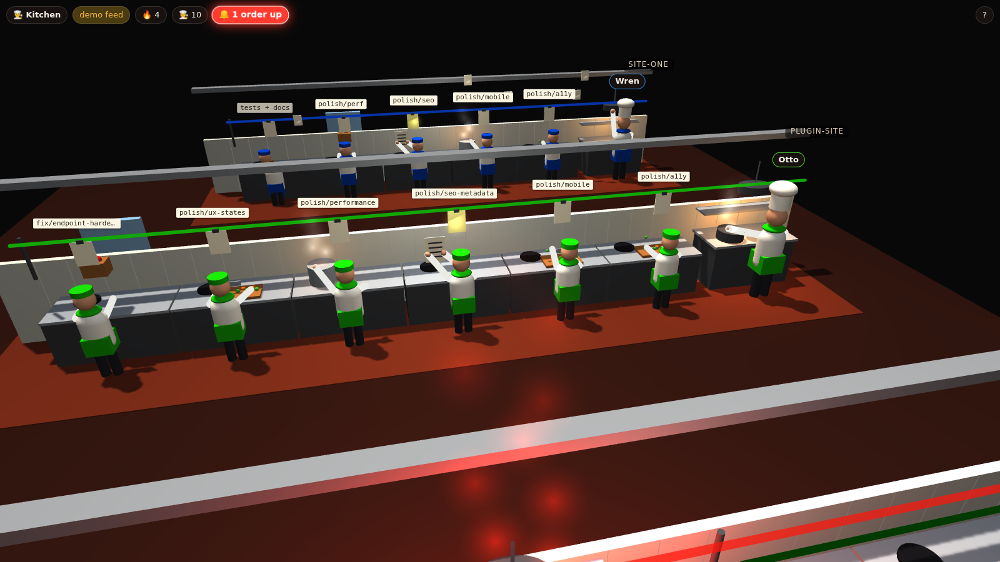
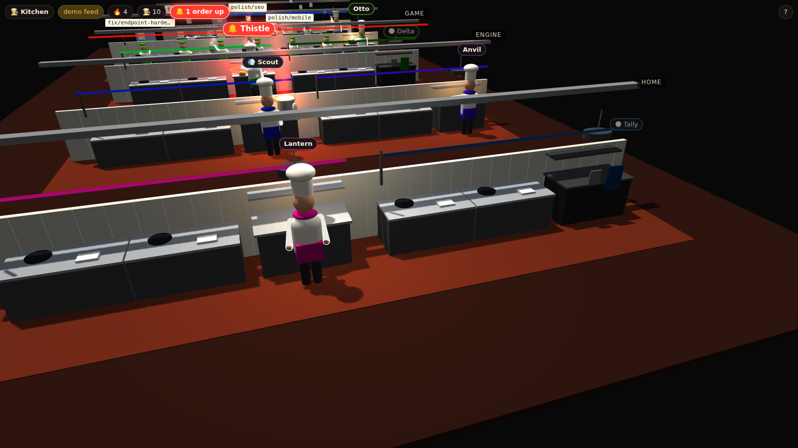
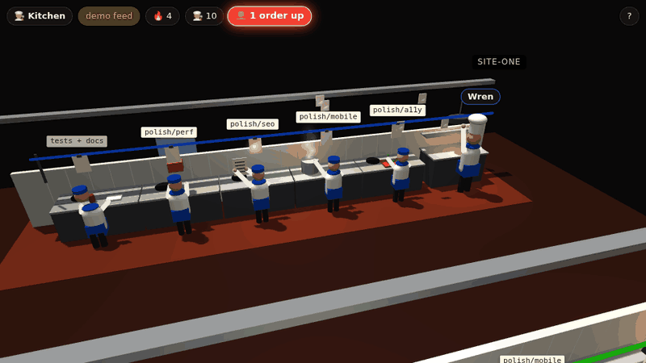
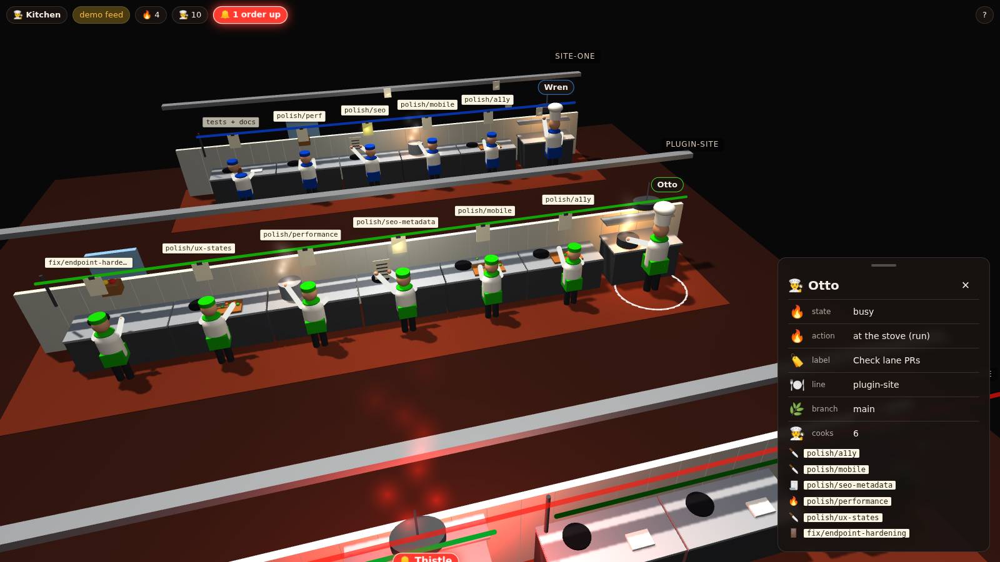
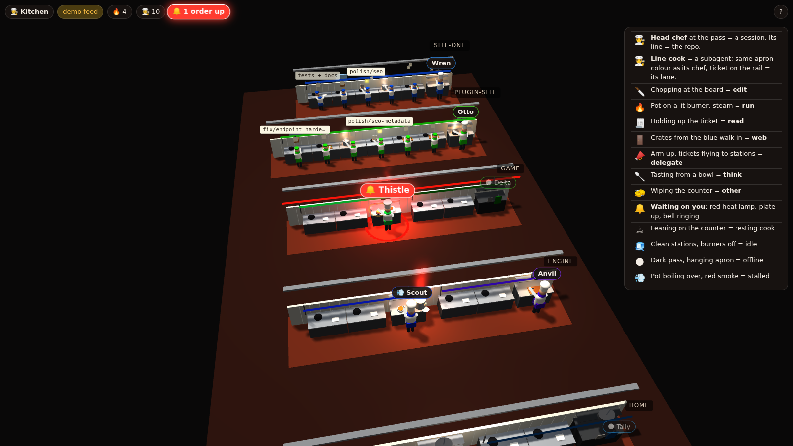

# agentviz-kitchen

Claude Code sessions as a restaurant kitchen brigade, drawn with
[Strata](https://github.com/Preponderous-Software/strata) 0.10.0's web kit.
One of the visualizations in [agentviz](https://github.com/dmccoystephenson/agentviz),
which also holds the shared feed (`vendor/agentfeed`).


*The whole kitchen (demo feed). Each line is a repo; each head chef at a pass is a
session; the cooks along the line are its subagents. The red pass in the middle is
the session waiting on you, and the chip at the top counts it.*

Every image here comes from the synthetic fixture feed, never from live sessions.

## What you're looking at

| You see | It means |
|---|---|
| A kitchen line (counter, tiled backsplash, place name on the left) | one place (repo / working directory) |
| A head chef in a tall toque at a pass under a heat lamp | one session |
| Line cooks at stations along the same line, aprons and rail in the chef's colour | that session's subagents |
| A paper ticket clipped to the rail above a station | the subagent's lane label |
| Chopping at a board, veg bits flying | **edit** |
| Pot on a lit burner, flames and steam | **run** |
| Holding up the ticket; the rail ticket glows | **read** |
| Crates coming over the counter from a blue walk-in door, frost spilling | **web** |
| Chef's arm up, tickets flying along the rail to the stations | **delegate** |
| Chef tasting from a bowl, spoon to mouth | **think** |
| Wiping the counter with a cloth | **other** |
| Red heat lamp pulsing, a plate up, the service bell ringing, a red ring and glow, a red bar over the line, a red label and a pulsing "order up" chip | **waiting**: the session needs you |
| A cook leaning on the counter with a mug | resting subagent (quiet for 2+ min) |
| Chef standing with arms down, lamp dim, stations clean, burners off | idle |
| Dark pass, lamp off, an apron hanging on the shelf, no chef | offline |
| A stock pot boiling over with red smoke | stalled (busy, nothing written for 5+ min) |

Tap or click a chef or a cook to select it: a white ring marks it, the camera
eases over, and a panel (a bottom sheet on a phone) shows its name, state,
action, label, branch and line, and for a chef its cooks (tap one to jump to it).
The 🔔 chip at the top goes to the next session waiting on you. **?** opens the legend.

### Close-ups


*A lead with its subagents: Otto at the stove at the pass, six cooks along his line
(green aprons and rail), each with its lane ticket above.*


*Waiting on you: Thistle's heat lamp turns red and pulses, a plate sits under it,
the bell rings and a red ring pulses on the floor.*


*Idle and offline: Lantern stands at a clean pass with burners off; Tally's pass is
dark with an apron hanging on it.*


*A resting subagent ("tests + docs") leaning on the counter beside busy cooks.*


*Stalled: Scout (busy, but nothing written for over five minutes) has a stock pot
boiling over at the pass, red smoke rising, and a 💨 on the name.*

### Moving


*Five seconds of Wren's line: tickets fly from the pass while the cooks chop,
stir, read and fetch from the walk-in.*

### Angles, panel, phone


*From the side, low.*


*From above: lines as rows, brigade colours on the rails.*


*A chef selected on desktop: the panel lists state, action, label, branch and its cooks.*


*The in-page legend (**?**).*


*Phone portrait (390 × 844, DPR 3): touch orbit and pinch, and the bottom sheet
open on the session that needs you.*

## Run

```bash
python3 -m vendor.agentfeed serve --web web --port 8842            # live sessions
python3 -m vendor.agentfeed serve --web web --port 8842 --fixture  # demo feed
```

Open http://127.0.0.1:8842/ (`?fixture=1` shows the demo feed on a live server,
`?fps=1` the kit's frame stats). The page polls `/api/agents` every 2 s and eases
between snapshots. The server binds to 127.0.0.1 only.

## Build

The built `web/kitchen-engine.{js,wasm}` and the kit's page scripts are committed,
so running needs only Python. To rebuild after editing `scene/main.cpp`
(needs emsdk 6.0.11; downloads the pinned Strata 0.10.0 release into `.strata/`):

```bash
scene/build.sh
```

## Test

```bash
python3 -m unittest discover -s tests                          # serve the fixture: page, assets, feed
NODE_PATH=<node_modules with playwright> node tests/smoke.cjs        # headless load, pick, no console errors
NODE_PATH=<node_modules with playwright> node tests/screenshots.cjs  # regenerate docs/media/
```

Layout: `scene/main.cpp` draws (Strata kit), `web/kitchen.js` lays the kitchen out
from the feed, keys everything by id and hands the scene its rows each frame.
