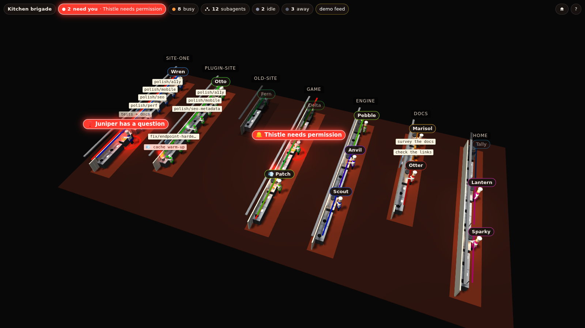
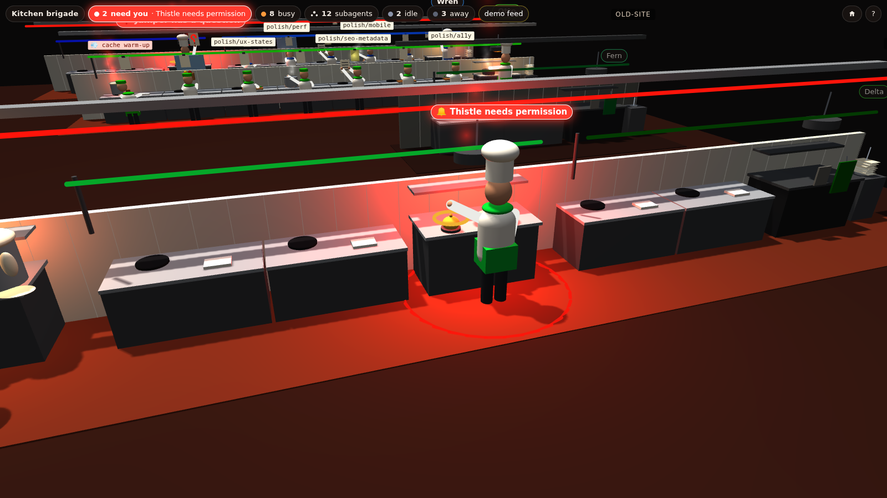
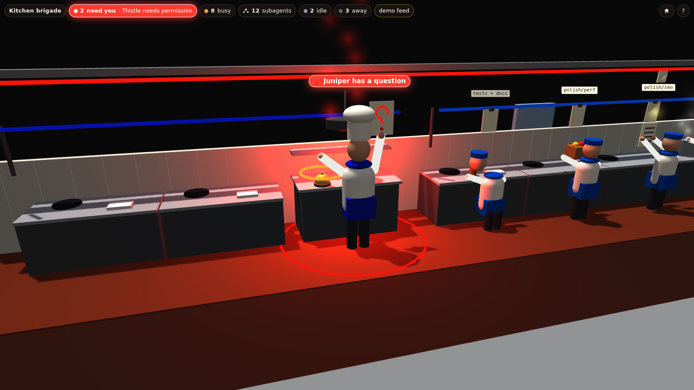
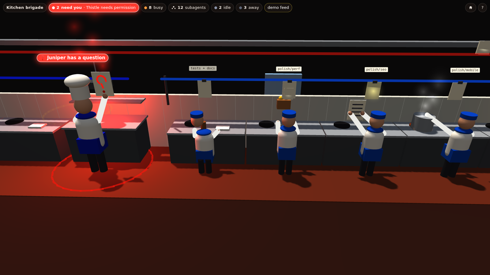
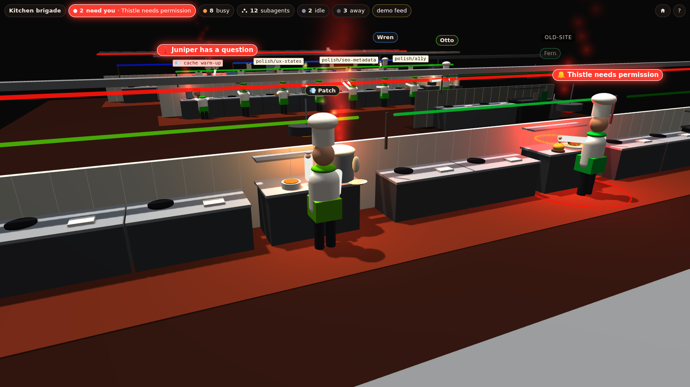
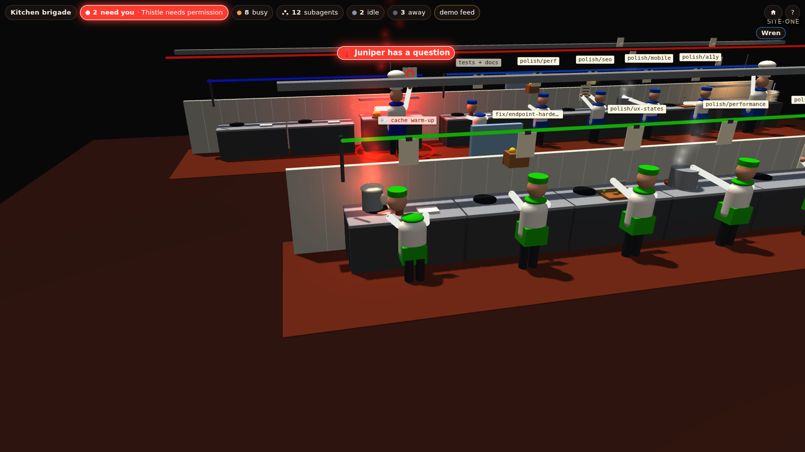
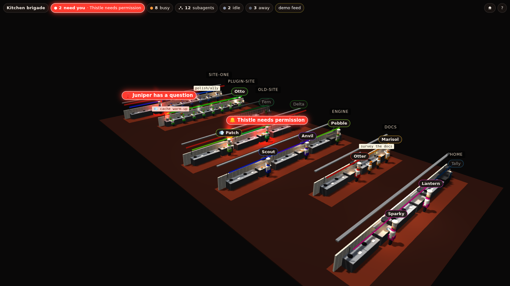
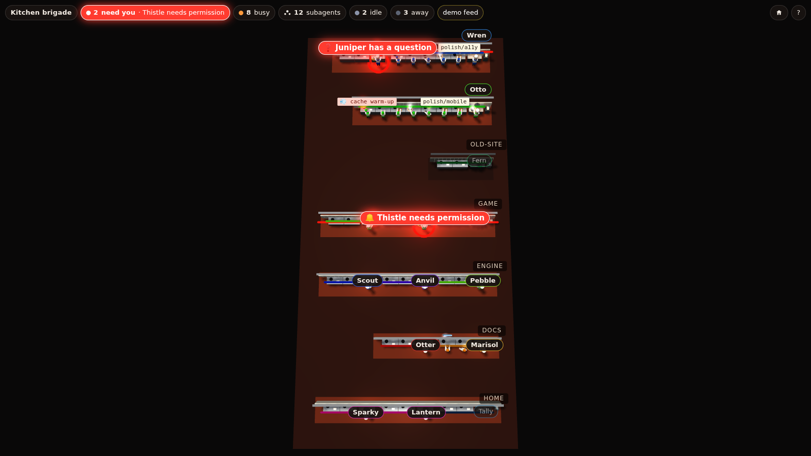
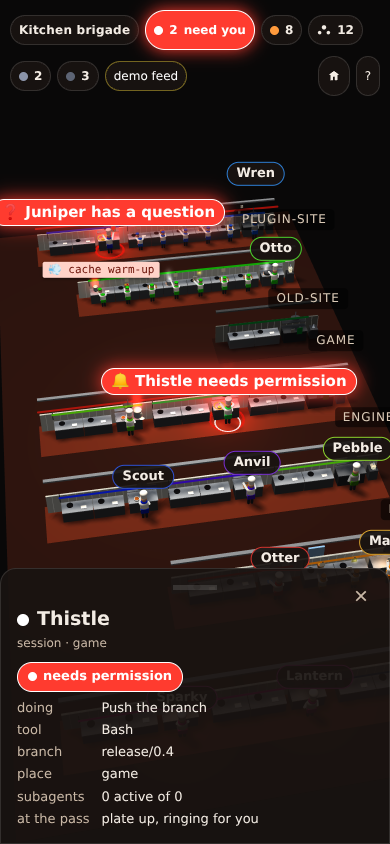

# agentviz-kitchen

Your Claude Code sessions and their subagents as a restaurant kitchen
brigade, drawn with [Strata](https://github.com/Preponderous-Software/strata)
0.10.0's web kit. Each repo is a kitchen line, each session is a head chef at
the pass under a heat lamp, and its subagents are line cooks at stations
along the same line. When a session needs you, its heat lamp turns red, the
service bell rings and the chef either puts a plate up for your sign-off or
holds up a ticket with a question mark.

One of the [agentviz](https://github.com/dmccoystephenson/agentviz) family:
ten views of the same feed.


*The whole kitchen (demo feed). Seven lines, one per repo. Wren and Otto lead
brigades of 5 and 7 cooks; Juniper (a question) and Thistle (a permission
prompt) are waiting on you, with red labels and red lamps; Patch's pot is
boiling over; Fern, Delta and Tally have gone home.*

Every image here comes from the synthetic fixture feed, never from live sessions.

## Run

Needs Python 3.8 or newer and nothing else:

```bash
git clone https://github.com/dmccoystephenson/agentviz-kitchen
cd agentviz-kitchen
python3 -m vendor.agentfeed serve --web web --port 8842            # your live sessions
python3 -m vendor.agentfeed serve --web web --port 8842 --fixture  # the demo feed
```

Open <http://127.0.0.1:8842/> (the server binds 127.0.0.1 only and refuses
non-local `Host` headers). Live mode reads your Claude Code session files
under `~/.claude` and shows session names, states, git branches, tool names
and short labels (a file's basename, a Bash command's own description, a web
host, a subagent's description), never file contents, commands or prompts;
see the agentviz [SECURITY.md](https://github.com/dmccoystephenson/agentviz/blob/main/SECURITY.md).
Query options: `?fixture=1` (demo feed), `?demo=1` (demo feed with scripted
changes, to watch cooks switch tasks and new tool calls flare), `?fps=1`
(frame stats), `?quality=0|1|2`.

Drag to orbit, right-drag or two fingers to pan, wheel or pinch to zoom. Tap
a chef or a cook to select it: a white ring marks it, the camera eases over,
and a card (a bottom sheet on a phone; swipe it down or tap the cross to
close) shows its state, what it is doing, its tool, branch and line, and for
a chef its cooks as chips you can tap to jump to. The red **need you** chip
names who is waiting and why (a question, or a permission prompt) and cycles
through them; the house button recentres; **?** opens the legend. If the feed
stops answering, a banner says so and the last snapshot stays; with no
sessions at all, a hint says how to start.

## What you're looking at

| You see | It means | Close-up |
|---|---|---|
| A kitchen line (counter, tiled backsplash, place name at its head) | one place (repo / working directory) | [hero](docs/media/hero.png) |
| A spike of spent tickets at the head of the line | the repo's tool calls so far: one more ticket per doubling | [brigade](docs/media/closeup-brigade.png) |
| A head chef in a tall toque at a pass under a heat lamp | one session | [brigade](docs/media/closeup-brigade.png) |
| Line cooks at stations along the same line, caps, aprons and rail in the chef's colour | that session's subagents | [brigade](docs/media/closeup-brigade.png) |
| A paper ticket clipped to the rail above a station | the subagent's lane label | [brigade](docs/media/closeup-brigade.png) |
| Chopping at a board, veg bits flying | **edit** | [brigade](docs/media/closeup-brigade.png) |
| Pot on a lit burner, flames and steam | **run** | [brigade](docs/media/closeup-brigade.png) |
| Holding up the ticket; the rail ticket glows | **read** | [resting](docs/media/closeup-resting.png) |
| Crates coming over the counter from a blue walk-in door, frost spilling | **web** | [brigade](docs/media/closeup-brigade.png) |
| Chef's arm up, tickets flying along the rail to the stations | **delegate** | [GIF](docs/media/kitchen.gif) |
| Chef tasting from a bowl, spoon to mouth | **think** | [stalled](docs/media/closeup-stalled.png) |
| Wiping the counter with a cloth | **other** | [idle-offline](docs/media/closeup-idle-offline.png) |
| A flare of sparks off the burner, the rail ticket hopping | a new tool call, just now | [GIF](docs/media/kitchen.gif) |
| Red heat lamp pulsing, the service bell ringing, a red ring and glow, a red bar over the line, a red label and the chip | **waiting**: the session needs you | [waiting](docs/media/closeup-waiting.png) |
| ... with a plate up under the lamp | waiting on a permission prompt | [waiting](docs/media/closeup-waiting.png) |
| ... with a ticket held high carrying a red "?" | waiting on a question | [question](docs/media/closeup-question.png) |
| A cook leaning on the counter with a mug | resting subagent (quiet for 2+ min) | [resting](docs/media/closeup-resting.png) |
| Chef standing with arms down, lamp dim | idle | [idle-offline](docs/media/closeup-idle-offline.png) |
| Dark pass, lamp off, an apron hanging on the shelf, no chef | offline | [idle-offline](docs/media/closeup-idle-offline.png) |
| A stock pot boiling over with red smoke, 💨 on the label | stalled: a chef busy with nothing written for 5+ min, or a cook quiet that long without finishing | [stalled](docs/media/closeup-stalled.png), [cook](docs/media/closeup-stalled-cook.png) |
| Clean, empty stations with a folded towel | room on the line (every brigade has at least two stations) | [waiting](docs/media/closeup-waiting.png) |

## Screenshots

### Close-ups


*A lead with its subagents: Otto at the stove at the pass (his ticket spike,
crowded after 338 tool calls, beside him), seven cooks along his line
(green caps, aprons and rail), each with its lane ticket above. At the far
end the stalled "cache warm-up" cook's pot boils over.*


*Waiting on a permission prompt: Thistle's heat lamp turns red and pulses, a
plate sits under it for your sign-off, the bell rings and a red ring pulses
on the floor.*


*Waiting on a question: Juniper rings the bell and holds up a ticket with a
red "?".*


*Idle and offline: Lantern stands at a clean pass with his arms down; Tally's
pass (right) is dark with an apron hanging on it; Sparky wipes the counter
(`other`).*


*A resting subagent ("tests + docs") leaning on the counter beside busy
cooks, with Juniper's question ticket at the next pass.*


*Stalled: Patch (busy, but nothing written for over five minutes) has a stock
pot boiling over at the pass, red smoke rising, and a 💨 on the name.*


*A stalled subagent: "cache warm-up" has been quiet for over five minutes
without finishing, so a smaller pot boils over at its station and its ticket
label turns pink with a 💨.*

### Moving


*Five seconds of Wren's line under `?demo=1`: Wren switches between reading
and calling tickets (slips fly along the rail), the cooks switch between
chopping, the stove, reading and the walk-in, and every new tool call
throws a flare of sparks off the burner.*

### Angles, panel, phone


*From a low diagonal.*


*From above: the lines as rows, brigade colours on the rails.*


*A chef selected on desktop: the card lists state, action, what it is doing,
branch, what it is up to at the pass, and its cooks as chips.*


*The in-page legend (**?**).*



*Phone portrait (390 x 844, DPR 3): the lines stack top to bottom, touch
orbit and pinch, and the bottom sheet open on Thistle, who needs permission.*

## Build and test

```bash
python3 -m unittest discover -s tests       # serves the fixture; page, assets, feed, vendored PINs
npm ci && npx playwright install chromium   # Playwright 1.61.1, for the browser tests
pip install -r requirements-dev.txt         # Pillow, for the GIF
npm run smoke                               # headless Chromium on the demo feed; saves docs/media/screenshot.png
npm run screenshots                         # every image above (or some: npm run screenshots -- hero phone kitchen)
EMSDK=/path/to/emsdk vendor/agentviz-kit/scene/build-scene.sh scene/kit.conf   # rebuild web/kitchen-engine.*
```

The built engine files are committed, so serving needs only Python. The
scene build needs emsdk 6.0.11 and downloads the pinned Strata 0.10.0
release into `.strata/`. Tests use port 9101 (`KITCHEN_TEST_PORT`
overrides). `vendor/agentfeed/`, `vendor/agentviz-kit/` and `web/agentviz-*`
come from [agentviz](https://github.com/dmccoystephenson/agentviz)
(`tools/vendor-kit.sh`); do not edit them here.

## How it works

The feed client, the HUD (chips, the selected-agent card and bottom sheet,
the banner, the empty state), world labels, tap picking and the page-to-engine
data format are the shared agentviz kit (docs/KIT.md in agentviz). On top of
it, `web/kitchen-model.js` keys everything by id, lays out one line per place,
gives each subagent a stable station slot and eases chefs and cooks to new
places; `web/page.js` owns the camera (on a wide screen it looks down the
stack of lines from the side, on a tall one along them) and the world labels.
Each frame `web/kitchen-frame.js` packs the scene in the agentviz wire
format; `scene/main.cpp` decodes it with `agentviz.h` and draws it with
Strata's primitives, lines, points and point lights (`line.h`, `chef.h`,
`station.h`, `person.h`, `draw_util.h`).

## Licence

Code: [MIT](LICENSE). Screenshots and GIFs in `docs/media/`:
[CC0 1.0](LICENSE-media). The committed engine bundles Strata (MIT) and its
libraries, and the Emscripten runtime: see
[THIRD_PARTY_NOTICES.md](THIRD_PARTY_NOTICES.md).
